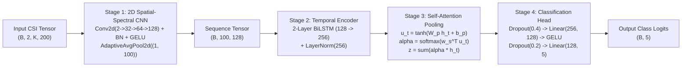

# Design and Implementation of Human Presence and Motion Sensing System Based on Wi-Fi CSI and Deep Neural Networks


> **B.Sc. Thesis Research Prototype (`v0.1`)**  
> **Author:** Nima Rezaei  
> **Supervisor:** Dr. Hassan Bashiri  
> **Department:** Department of Computer Engineering, Hamedan University of Technology  

---

## 1. Abstract & Overview

Device-free human presence and activity sensing using Orthogonal Frequency-Division Multiplexing (OFDM) Wi-Fi **Channel State Information (CSI)** enables privacy-preserving indoor monitoring without wearable sensors or optical cameras. Unlike coarse Received Signal Strength Indicator (RSSI) measurements, fine-grained complex Channel Frequency Response (CFR) matrices capture subcarrier-level amplitude attenuation and phase shifts induced by multipath propagation, sub-centimeter chest wall respiration ($0.2\text{–}0.4\text{ Hz}$), and dynamic limb/torso Doppler reflections ($1.0\text{–}14.0\text{ Hz}$).

This repository implements the **`v0.1` production-grade research prototype** for our B.Sc. thesis, featuring:
1. **Physics-Based Multi-Class CFR Simulator (`SyntheticCSIDataset`):** Synthesizes realistic IEEE 802.11n $20\text{ MHz}$ complex CSI streams ($K = 52$ for ESP32-CSI-Tool or $K = 90$ for Widar3.0 $3 \times 30$ links, $f_s = 100\text{ Hz}$, $W = 2.0\text{ s}$, $T = 200$ packets, $50\%$ stride) across $C = 5$ classes (`Empty`, `Stationary_Presence`, `Walking`, `Sitting_Standing`, `Falling`) with Carrier Frequency Offset (CFO) / Sampling Frequency Offset (SFO) phase distortions, impulsive noise spikes, and complex AWGN.
2. **Hardware Dataset Adapters (`Widar3Dataset` & `ESP32CSIDataset`):** Native binary `.dat` (Intel 5300 CSI Tool) and serial `.csv` (`ESP32-CSI-Tool`) log parsers.
3. **Deterministic Digital Signal Processing Pipeline (`SignalPreprocessor`):** Linear least-squares phase sanitization across symmetric OFDM subcarriers, temporal Hampel outlier rejection, zero-phase 3rd-order Butterworth bandpass filtering ($0.1\text{–}15.0\text{ Hz}$), Short-Time Fourier Transform (STFT) spectrogram extraction, and per-window Z-score normalization.
4. **Hybrid Spatio-Temporal Deep Neural Network (`CSISpatioTemporalNet`):** Combines a 2D Spatial-Spectral CNN encoder, a 2-layer Bidirectional LSTM sequence model, additive Temporal Self-Attention pooling, and a regularized classification head.

---

## 2. Target Classes & Signal Format ($C = 5$)

Each sliding window represents a complex baseband CFR matrix $H \in \mathbb{C}^{K \times T}$ sampled at $f_s = 100\text{ Hz}$ over $W = 2.0\text{ s}$ ($T = 200$ packets) with a $50\%$ overlap stride ($100$ packets):

| Class ID | Class Name | Physical & Spectral Signature | Dominant Frequency Band |
| :---: | :--- | :--- | :---: |
| `0` | `Empty` | Static indoor multipath reflections + thermal AWGN floor | $< 0.1\text{ Hz}$ (attenuated) |
| `1` | `Stationary_Presence` | Quasi-static posture + periodic chest wall respiration | $0.2\text{ – }0.4\text{ Hz}$ |
| `2` | `Walking` | Continuous multi-scatterer torso & limb Doppler oscillations | $2.0\text{ – }8.0\text{ Hz}$ |
| `3` | `Sitting_Standing` | Localized mid-window Gaussian-envelope posture transition | $1.0\text{ – }4.0\text{ Hz}$ |
| `4` | `Falling` | High-velocity chirped Doppler burst followed by abrupt stillness | $6.0\text{ – }14.0\text{ Hz}$ |

---

## 3. Mathematical Formulation of the DSP Pipeline

Given a raw complex CFR window $H \in \mathbb{C}^{K \times T}$, `SignalPreprocessor` executes six deterministic stages sequentially:

### 3.1 Raw Amplitude & Wrapped Phase Extraction
$$A(k, t) = |H(k, t)|, \qquad \phi_{\text{raw}}(k, t) = \angle H(k, t) \in [-\pi, \pi]$$

### 3.2 Phase Unwrapping & Linear CFO/SFO Phase Sanitization
Hardware oscillator lack of synchronization introduces a packet-varying timing offset slope $a_t$ and Carrier Frequency Offset / PLL random phase offset $b_t$:
$$\phi_{\text{unwrap}}(k, t) = \text{unwrap}_k\big(\phi_{\text{raw}}(k, t)\big) \approx \phi_{\text{true}}(k, t) + a_t m_k + b_t$$
where $m_k \in \{-K/2, \dots, -1, 1, \dots, K/2\}$ denotes the symmetric logical OFDM subcarrier index (excluding DC index $0$). By exploiting the exact symmetry $\sum_{k=1}^{K} m_k = 0$, the closed-form linear least-squares estimators for each packet $t$ are:
$$a_t = \frac{\sum_{k=1}^{K} m_k \, \phi_{\text{unwrap}}(k, t)}{\sum_{k=1}^{K} m_k^2}, \qquad b_t = \frac{1}{K} \sum_{k=1}^{K} \phi_{\text{unwrap}}(k, t)$$
$$\hat{\phi}(k, t) = \phi_{\text{unwrap}}(k, t) - (a_t m_k + b_t)$$

### 3.3 Sliding-Window Temporal Hampel Outlier Filter
To suppress non-Gaussian impulsive RF interference spikes without blurring sharp motion edges, a sliding window of length $W_h = 7$ is applied along the time axis $t$ independently for each subcarrier $k$:
$$\mu_{k,t} = \text{median}\big\{x(k, \tau)\big\}_{\tau=t-3}^{t+3}, \qquad \sigma_{k,t}^{\text{MAD}} = 1.4826 \cdot \text{median}\big\{\big|x(k, \tau) - \mu_{k,t}\big|\big\}_{\tau=t-3}^{t+3}$$
$$x_{\text{despiked}}(k, t) = \begin{cases} \mu_{k,t}, & \text{if } |x(k, t) - \mu_{k,t}| > 3.0 \, \sigma_{k,t}^{\text{MAD}} \\ x(k, t), & \text{otherwise} \end{cases}$$
applied to both $A(k, t)$ and $\hat{\phi}(k, t)$.

### 3.4 Zero-Phase 3rd-Order Butterworth Bandpass Filter ($0.1\text{–}15.0\text{ Hz}$)
Static wall/furniture multipath ($0\text{ Hz}$ DC) and high-frequency electronic noise ($>15.0\text{ Hz}$) are removed via forward-backward zero-phase IIR filtering (`scipy.signal.filtfilt`) using a 3rd-order Butterworth bandpass transfer function with passband $[f_{\text{low}}, f_{\text{high}}] = [0.1\text{ Hz}, 15.0\text{ Hz}]$ at $f_s = 100.0\text{ Hz}$. Setting $f_{\text{low}} = 0.1\text{ Hz}$ is critical to preserve fundamental human respiration harmonics ($0.2\text{–}0.4\text{ Hz}$).

### 3.5 Short-Time Fourier Transform (STFT) Doppler Spectrogram Utility
For time-frequency Doppler analysis, `compute_stft` evaluates the discrete STFT using a periodic Hann window $w[n]$ of length $L = 32$, hop size $R = 8$ ($75\%$ overlap), and $N_{\text{FFT}} = 64$:
$$\text{STFT}\{x\}(k, f, m) = \left| \sum_{n=0}^{L-1} x(k, mR + n) \, w[n] \, e^{-j 2\pi f n / N_{\text{FFT}}} \right| \in \mathbb{R}^{K \times 33 \times 26}$$

### 3.6 Tensor Stacking & Per-Window Z-Score Normalization
The filtered amplitude $A_{\text{filt}}$ and sanitized/filtered phase $\hat{\phi}_{\text{filt}}$ are stacked into a dual-channel tensor $X_{\text{raw}} \in \mathbb{R}^{2 \times K \times T}$ and normalized per channel $c \in \{0, 1\}$ and subcarrier $k$ across time $t \in \{1, \dots, T\}$ ($\epsilon = 10^{-8}$):
$$X(c, k, t) = \frac{X_{\text{raw}}(c, k, t) - \mu_{c,k}}{\sigma_{c,k} + \epsilon}$$

---

## 4. Deep Spatio-Temporal Architecture (`CSISpatioTemporalNet`)



### Layer-by-Layer Tensor Progression
```text
Input Tensor X                        : (B, 2, K, 200)      [K = 52 (ESP32) or K = 90 (Widar3.0)]
 ├─ Conv2d(2, 32, k=(5,3), s=(2,1))   : (B, 32, ceil(K/2), 200)  + BatchNorm2d + GELU + Dropout2d(0.15)
 ├─ Conv2d(32, 64, k=(3,3), s=(2,2))  : (B, 64, ceil(K/4), 100)  + BatchNorm2d + GELU + Dropout2d(0.15)
 ├─ Conv2d(64, 128, k=(3,3), s=(2,1)) : (B, 128, ceil(K/8), 100) + BatchNorm2d + GELU
 ├─ AdaptiveAvgPool2d((1, 100))       : (B, 128, 1, 100)    [Subcarrier-count agnostic bottlenecks]
 ├─ Squeeze(2) & Permute(0, 2, 1)     : (B, 100, 128)
 ├─ 2-Layer BiLSTM(128 -> 2x128)      : (B, 100, 256)       + LayerNorm(256)
 ├─ Temporal Self-Attention Pooling   : z in (B, 256), alpha in (B, 100, 1)
 └─ MLP Classifier (256 -> 128 -> 5)  : Logits in (B, 5)
```

---

## 5. Repository Structure

```text
wifi-csi-human-sensing/
├── configs/
│   └── default_config.yaml       # Signal, DSP, synthetic generator, model & training config
├── scripts/
│   ├── train.py                  # CLI training pipeline (--config, --smoke-test)
│   └── evaluate.py               # CLI checkpoint evaluation & confusion matrix exporter
├── src/
│   ├── __init__.py
│   ├── data/
│   │   ├── __init__.py
│   │   ├── synthetic_csi.py      # Physics-based 5-class complex CFR simulator
│   │   ├── loaders.py            # Widar3Dataset (.dat) & ESP32CSIDataset (.csv) loaders
│   │   └── augmentations.py      # Training-only RF jitter & subcarrier/temporal masking
│   ├── dsp/
│   │   ├── __init__.py
│   │   └── preprocessor.py       # Phase sanitization, Hampel, Butterworth & STFT cascade
│   ├── models/
│   │   ├── __init__.py
│   │   └── csi_net.py            # CSISpatioTemporalNet (2D-CNN + BiLSTM + Self-Attention)
│   └── engine/
│       ├── __init__.py
│       ├── metrics.py            # Top-1 Acc, Macro P/R/F1, 5x5 Confusion Matrix & Presence FPR
│       └── trainer.py            # AdamW, Warmup+Cosine LR, Stratified 70/15/15 Split & Trainer
├── tests/
│   ├── __init__.py
│   ├── test_dsp.py               # Unit tests for phase sanitization, Hampel, Butterworth & STFT
│   ├── test_model.py             # Unit tests for K=52/90 shapes, attention weights & gradients
│   └── test_pipeline.py          # Integration tests for dataset, augmentations, metrics & trainer
├── requirements.txt
├── .gitignore
└── README.md
```

---

## 6. Quickstart & Verification

### 6.1 Environment Installation
```bash
pip install -r requirements.txt
```

### 6.2 Run the Automated Unit Test Suite
```bash
python -m unittest discover -s tests -v
```

### 6.3 Run a Fast 2-Epoch Smoke Test
```bash
python scripts/train.py --config configs/default_config.yaml --smoke-test
```
This synthesizes a stratified 100-window dataset, runs 2 training epochs with warmup scheduling, evaluates on the held-out test split, and saves `outputs/best_model.pt` and `outputs/evaluation_summary.json`.

### 6.4 Full 50-Epoch Training & Evaluation
```bash
# Train for 50 epochs on 1,000 physics-based CSI windows (70% train / 15% val / 15% test)
python scripts/train.py --config configs/default_config.yaml

# Evaluate saved checkpoint on the test split and export 5x5 confusion matrix
python scripts/evaluate.py --config configs/default_config.yaml --checkpoint outputs/best_model.pt
```

---

## 7. Research Roadmap

| Milestone | Target Version | Scope & Technical Deliverables | Status |
| :---: | :---: | :--- | :---: |
| **Phase 1** | **`v0.1` (Current)** | **Physics-Based CFR Simulator, DSP Pipeline & `CSISpatioTemporalNet` Prototype** | **Completed** |
| **Phase 2** | `v0.2` | Widar3.0 Cross-Domain (Cross-User & Cross-Room) Generalization Benchmark | Planned |
| **Phase 3** | `v0.3` | Real-World ESP32-CSI-Tool (`ESP-IDF v5.3`) Hardware Data Acquisition & Fine-Tuning | Planned |
| **Phase 4** | `v0.4` | Multi-Modal Fusion with 24GHz mmWave Radar (`LD2420`) for False-Alarm Suppression | Planned |
| **Phase 5** | `v0.5` | INT8 Quantization & LiteRT Edge Deployment | Planned |

---

## 8. Academic Citation

If you reference this codebase or the DSP/neural architecture in academic work, please cite:

```bibtex
@mastersthesis{rezaei2026wificsi,
  author       = {Nima Rezaei},
  title        = {Design and Implementation of Human Presence and Motion Sensing System Based on Wi-Fi CSI and Deep Neural Networks},
  school       = {Department of Computer Engineering, Hamedan University of Technology},
  year         = {2026},
  type         = {B.Sc. Thesis},
  note         = {Supervisor: Dr. Hassan Bashiri}
}
```
